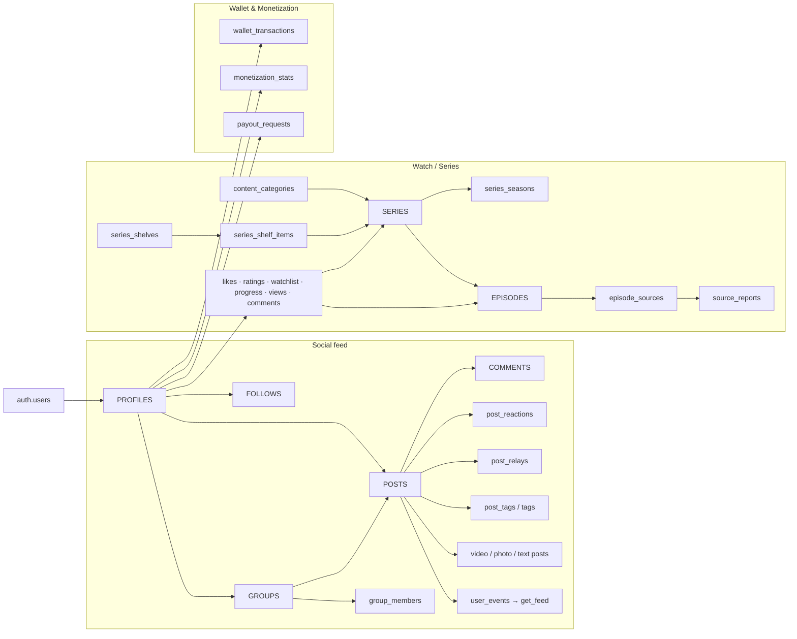

# Qylomi — Database Schema Documentation

> **Project:** Qylomi · `ffbmozwsasbhevtehbit` · ap-southeast-1 · Postgres 17
> **Updated:** 2026-11-01 (Audited & Aligned with Android App Code)
> **Full SQL:** `QYLOMI_SCHEMA_SQL.md`

## Summary

| Item | Count |
|---|---|
| Tables (public) | 39 (RLS enabled on all) |
| Foreign keys | 67 |
| Indexes (non-PK) | ~102 (cleaned up 8 duplicate/redundant indexes) |
| Custom Functions | 18 `private` + 31 `public` RPCs |
| Triggers | 49 (includes updated_at, counters, and security guards) |
| RLS policies | ~135 (all performance-wrapped with `(select auth.uid())`) |
| Storage buckets | 1 (`qylomi-images`, public, 10MB limit) |
| Extensions | pg_cron, pg_net, pg_stat_statements, pg_trgm, pgcrypto, uuid-ossp |

---

## 1. Domain Map & Architecture

---

## 2. Key Entity Relations & Triggers

### 2.1 Profiles & Followers
- `profiles.id` ↔ `auth.users.id` (1:1 CASCADE).
- `follows` automatically maintains `profiles.trackers_count` via `trg_follows_trackers_count`.
- `profiles.points`, `creator_rank`, `creator_level`, `badges`, `points_history` are frozen against direct non-admin client updates via `trg_freeze_profile_stats`.

### 2.2 Social Feed & Engagement
- `posts` ↔ `video_posts`, `photo_posts`, `text_posts` (1:1 typed extension tables via post ownership check `posts.user_id = (select auth.uid())`).
- `post_reactions` maintains `posts.appreciations_count` via `trg_post_reaction_count`.
- `comments` maintains `posts.replies_count` via `trg_post_comment_count` and enforces `posts.allow_comments = true`.
- `post_relays` maintains `posts.relays_count` via `trg_post_relay_count`.
- `post_tags` maintains `tags.posts_count` via `trg_post_tags_count`.
- `posts` maintains `groups.posts_count` via `trg_group_posts_count`.

### 2.3 Wallet & Monetization
- `wallet_transactions` row writes are strictly gated to the `process_creator_wallet_transaction` SECURITY DEFINER RPC. Direct client `INSERT` policies are disabled.
- `monetization_stats` writes are restricted to `increment_monetization_stats` SECURITY DEFINER RPC and admin roles. Client `INSERT`/`UPDATE` policies are disabled.

---

## 3. Change Log & Audit Summary (2026-11-01)

| Issue # | Area | Description of Fix |
|---|---|---|
| 1 | `monetization_stats` | Removed user direct write policy. Locked updates to `increment_monetization_stats` SECURITY DEFINER RPC. |
| 2 | `wallet_transactions` | Removed user direct `INSERT` policy. All wallet mutations now pass through `process_creator_wallet_transaction`. |
| 3 | `profiles` | Added `trg_freeze_profile_stats` trigger to freeze `points`, `creator_rank`, `creator_level`, `badges`, and `points_history` against user edits. |
| 4 | `typed_posts` | Replaced `WITH CHECK (true)` and `anon` policies on `video_posts`, `photo_posts`, `text_posts` with post ownership check `posts.user_id = (select auth.uid())`. |
| 5 | `comments` | Dropped permissive `Authenticated users can write comments` policy to enforce `allow_comments = true` check. |
| 6 | `notifications` | Restricted direct client `INSERT` policy; notifications must be sent via `send_notification()` RPC or system triggers. |
| 7 | `post_tags` | Added post ownership check `posts.user_id = (select auth.uid())` to `post_tags` insert/delete policies. |
| 8 | `profiles.trackers_count` | Added missing `trackers_count` integer column to `profiles` and attached trigger on `follows`. |
| 9 | `counters` | Added `trg_post_tags_count` for `tags.posts_count` and `trg_group_posts_count` for `groups.posts_count`. |
| 10 | `auth.users` | Verified `handle_new_user()` and attached `on_auth_user_created` trigger on `auth.users`. |
| 11 | `indexes` | Cleaned up duplicate unique keys (`unique_group_user`) and duplicate non-PK indexes (`idx_post_tags_tag_id`, `source_reports_source_idx`, etc.). |
| 12 | `legacy_fns` | Dropped deprecated functions `handle_post_reaction_count`, `handle_post_relays_count`, `handle_post_replies_count`. |
| 13 | `posts.type` | Consolidated `'Pixel Art'` and `'PixelArt'` into `'PixelArt'` and updated column CHECK constraint. |
| 14 | `RLS Performance` | Wrapped all `auth.uid()` invocations with `(select auth.uid())` across all RLS policies. |
| 15 | `updated_at` | Added `trg_*_set_updated_at` triggers for `profiles`, `posts`, `playlists`, and `groups`. |
